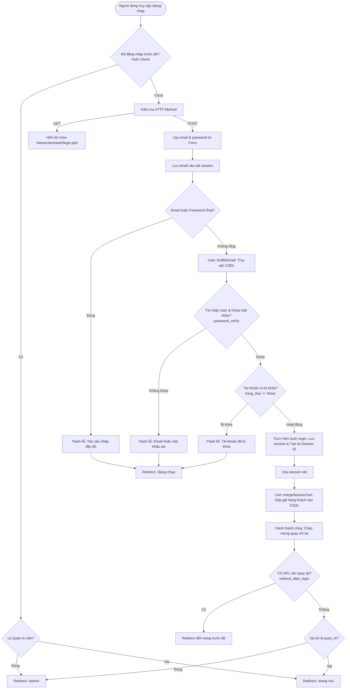

# TÀI LIỆU GIẢI THÍCH CHI TIẾT CHỨC NĂNG ĐĂNG NHẬP (AUTHENTICATION)
**Dự án:** Website Bán Sách Trực Tuyến (DQP Book Store)  
**Kiến trúc:** MVC thuần (Model - View - Controller) với PHP & MySQL (PDO)

---

## MỤC LỤC
1. [Tổng Quan Kiến Trúc & Các File Tham Gia](#1-tổng-quan-kiến-trúc--các-file-tham-gia)
2. [Sơ Đồ Luồng Hoạt Động (Activity Flowchart)](#2-sơ-đồ-luồng-hoạt-động-activity-flowchart)
3. [Giải Thích Chi Tiết Từng Thành Phần & Mã Nguồn](#3-giải-thích-chi-tiết-từng-thành-phần--mã-nguồn)
   - [3.1. Cấu hình Phiên & Định tuyến (Config & Routing)](#31-cấu-hình-phiên--định-tuyến-config--routing)
   - [3.2. Giao diện Đăng nhập (View: login.php)](#32-giao-diện-đăng-nhập-view-loginphp)
   - [3.3. Điều khiển Luồng Xử lý (Controller: AuthController.php)](#33-điều-khiển-luồng-xử-lý-controller-authcontrollerphp)
   - [3.4. Quản lý Phiên & Phân quyền Toàn cục (Core: Auth.php)](#34-quản-lý-phiên--phân-quyền-toàn-cục-core-authphp)
   - [3.5. Truy vấn Cơ Sở Dữ Liệu (Model: User.php)](#35-truy-vấn-cơ-sở-dữ-liệu-model-userphp)
   - [3.6. Cơ chế Gộp Giỏ hàng Khách (Model: Cart.php)](#36-cơ-chế-gộp-giỏ-hàng-khách-model-cartphp)
4. [Các Giải Pháp An Toàn & Bảo Mật Áp Dụng](#4-các-giải-pháp-an-toàn--bảo-mật-áp-dụng)
5. [Tổng Kết](#5-tổng-kết)

---

## 1. TỔNG QUAN KIẾN TRÚC & CÁC FILE THAM GIA

Chức năng Đăng nhập trong hệ thống DQP Book Store được thiết kế theo đúng chuẩn mô hình **MVC** kết hợp với lớp dịch vụ tĩnh **Core/Auth** để kiểm soát phiên đăng nhập tập trung, an toàn và đồng bộ dữ liệu người dùng.

### Các file đảm nhiệm chức năng đăng nhập:

| Tầng | Đường dẫn file | Vai trò chính |
| :--- | :--- | :--- |
| **Routing & App** | `Core/App.php` | Định tuyến URL thân thiện `/dang-nhap` đến Controller. |
| **Config** | `Config/config.php` | Khởi động `session_start()`, cấu hình kết nối CSDL, múi giờ. |
| **Controller** | `Controllers/AuthController.php` | Tiếp nhận request, kiểm tra dữ liệu đầu vào, gọi Model & Auth service, phân luồng điều hướng. |
| **View** | `Views/client/auth/login.php` | Giao diện form đăng nhập, CSRF token, hỗ trợ autofill demo tài khoản, toggle ẩn/hiện mật khẩu. |
| **Model** | `Models/User.php` | Tương tác bảng `nguoi_dung` bằng PDO Prepared Statements để lấy thông tin tài khoản qua email. |
| **Core Service** | `Core/Auth.php` | Quản trị Session người dùng: đăng nhập, đăng xuất, kiểm tra quyền (`check`, `isAdmin`), chống Session Fixation, kiểm tra tài khoản bị khóa trong thời gian thực. |
| **Model Phụ trợ** | `Models/Cart.php` | Gộp giỏ hàng tạm thời lúc chưa đăng nhập (`$_SESSION['cart']`) vào tài khoản CSDL sau khi đăng nhập thành công. |
| **Helper** | `Core/Helper.php` | Các hàm tiện ích: `flash()`, `old()`, `redirect()`, `base_url()`, `csrf_field()`. |

---

## 2. SƠ ĐỒ LUỒNG HOẠT ĐỘNG (ACTIVITY FLOWCHART)



---

## 3. GIẢI THÍCH CHI TIẾT TỪNG THÀNH PHẦN & MÃ NGUỒN

### 3.1. Cấu hình Phiên & Định tuyến (Config & Routing)

#### `Config/config.php`:
Đảm bảo Session luôn được kích hoạt trước khi bất kỳ tiến trình nào chạy:
```php
if (session_status() === PHP_SESSION_NONE) {
    session_start();
}
```

#### `Core/App.php`:
Hệ thống Router ánh xạ đường dẫn thân thiện `dang-nhap` tới phương thức `login` của `AuthController`:
```php
protected array $routes = [
    // ...
    'dang-nhap' => ['AuthController', 'login'],
    'dang-xuat' => ['AuthController', 'logout'],
    // ...
];
```

---

### 3.2. Giao diện Đăng nhập (View: `Views/client/auth/login.php`)

Form đăng nhập bao gồm:
1. **CSRF Field**: Gọi hàm `<?= csrf_field() ?>` để sinh ra input ẩn chứa `csrf_token`, bảo vệ chống tấn công giả mạo yêu cầu (CSRF).
2. **Lưu lại Email cũ khi đăng nhập lỗi**:
   ```php
   value="<?= htmlspecialchars(old('email', '')) ?>"
   ```
   Hàm `old('email')` tự động lấy lại email mà người dùng vừa gõ nếu trước đó đăng nhập thất bại, tránh người dùng phải nhập lại từ đầu.
3. **Nút ẩn/hiện mật khẩu (Toggle Password Visibility)**:
   ```javascript
   function togglePasswordVisibility(inputId) {
       const input = document.getElementById(inputId);
       input.type = input.type === 'password' ? 'text' : 'password';
   }
   ```
4. **Nút hỗ trợ tài khoản thử nghiệm (Demo Autofill)**:
   Cho phép người kiểm thử hoặc giảng viên click nhanh tài khoản Quản trị (`admin@bookstore.vn`) hoặc Khách hàng (`nguyenvanan@gmail.com`) mà không cần gõ phím.

---

### 3.3. Điều khiển Luồng Xử lý (Controller: `Controllers/AuthController.php`)

Toàn bộ logic nghiệp vụ đăng nhập nằm trong phương thức `login()`:

```php
public function login(): void {
    // 1. Kiểm tra nếu đã đăng nhập thì không cho vào lại trang đăng nhập
    if (Auth::check()) {
        if (Auth::isAdmin()) {
            redirect('admin');
        }
        redirect('trang-chu');
    }

    // 2. Tiếp nhận xử lý khi người dùng submit Form (POST)
    if ($_SERVER['REQUEST_METHOD'] === 'POST') {
        $email = trim($_POST['email'] ?? '');
        $password = $_POST['password'] ?? '';

        // Lưu email tạm thời để điền lại vào form nếu có lỗi
        $_SESSION['old']['email'] = $email;

        // Validation kiểm tra dữ liệu bắt buộc
        if (empty($email) || empty($password)) {
            flash('error', 'Vui lòng nhập đầy đủ Email và Mật khẩu.');
            redirect('dang-nhap');
        }

        // Tìm người dùng trong database theo email
        $user = $this->userModel->findByEmail($email);

        // Kiểm tra tồn tại và so khớp mật khẩu băm Bcrypt
        if (!$user || !password_verify($password, $user['mat_khau_hash'])) {
            flash('error', 'Email hoặc mật khẩu không chính xác.');
            redirect('dang-nhap');
        }

        // Kiểm tra tài khoản có bị Ban/Khóa hay không
        if ($user['trang_thai'] === 'khoa') {
            flash('error', 'Tài khoản của bạn đã bị khóa. Vui lòng liên hệ quản trị viên.');
            redirect('dang-nhap');
        }

        // Thiết lập phiên đăng nhập chính thức
        Auth::login($user);
        unset($_SESSION['old']);

        // Gộp các sản phẩm trong giỏ hàng tạm (session) vào giỏ hàng CSDL
        $cartModel = new \Models\Cart();
        $cartModel->mergeSessionCart((int)$user['id']);

        flash('success', 'Chào mừng ' . htmlspecialchars($user['ho_ten']) . ' đã quay trở lại!');

        // Nếu trước đó người dùng bị chặn yêu cầu đăng nhập (ví dụ: bấm Thanh toán),
        // đưa họ trở lại đúng trang họ đang làm dở
        if (!empty($_SESSION['redirect_after_login'])) {
            $target = $_SESSION['redirect_after_login'];
            unset($_SESSION['redirect_after_login']);
            redirect($target);
        }

        // Điều hướng theo quyền hạn
        if ($user['vai_tro'] === 'quan_tri') {
            redirect('admin');
        }

        redirect('trang-chu');
    }

    // 3. Nếu là GET request, render giao diện đăng nhập
    $this->view('client.auth.login', [
        'title' => 'Đăng Nhập Tài Khoản | ' . APP_NAME
    ]);
}
```

---

### 3.4. Quản lý Phiên & Phân quyền Toàn cục (Core: `Core/Auth.php`)

Đây là class xử lý xác thực trọng tâm của dự án:

#### Hàm `Auth::login(array $user)`:
```php
public static function login(array $user): void {
    // Tiêu chuẩn bảo mật: Không bao giờ lưu chuỗi hash mật khẩu trong $_SESSION
    unset($user['mat_khau_hash']);
    
    $_SESSION['user'] = $user;
    
    // Chống tấn công Session Fixation (cố định phiên)
    if (!headers_sent()) {
        session_regenerate_id(true);
    }
}
```
* **Giải thích**: `session_regenerate_id(true)` sẽ tạo một mã Session ID hoàn toàn mới cho trình duyệt và xóa session ID cũ trên server ngay sau khi đăng nhập thành công. Điều này ngăn chặn hacker chiếm đoạt phiên nếu kẻ tấn công biết được Session ID ban đầu của nạn nhân trước khi đăng nhập.

#### Hàm `Auth::check()` & `Auth::verifyAccountStatus()`:
Hệ thống không chỉ tin tưởng mù quáng vào biến `$_SESSION['user']`, mà còn thực hiện kiểm tra chéo với CSDL:
```php
public static function check(): bool {
    if (!isset($_SESSION['user']['id'])) {
        return false;
    }

    // Kiểm tra an toàn trạng thái tài khoản trong DB theo thời gian thực
    return self::verifyAccountStatus();
}

public static function verifyAccountStatus(): bool {
    if (!isset($_SESSION['user']['id'])) {
        return false;
    }

    $userId = (int)$_SESSION['user']['id'];
    $db = Database::getInstance()->getConnection();
    $stmt = $db->prepare("SELECT id, ho_ten, email, vai_tro, trang_thai FROM nguoi_dung WHERE id = ? LIMIT 1");
    $stmt->execute([$userId]);
    $user = $stmt->fetch();

    // Nếu tài khoản bị Admin xóa hoặc chuyển trạng thái 'khoa' trong lúc đang online
    if (!$user || $user['trang_thai'] === 'khoa') {
        self::logout();
        flash('error', 'Tài khoản của bạn đã bị khóa hoặc không tồn tại. Vui lòng liên hệ hỗ trợ.');
        return false;
    }

    // Cập nhật lại họ tên, vai trò mới nhất vào session nếu Admin vừa đổi quyền
    $_SESSION['user']['ho_ten'] = $user['ho_ten'];
    $_SESSION['user']['vai_tro'] = $user['vai_tro'];
    $_SESSION['user']['trang_thai'] = $user['trang_thai'];

    return true;
}
```

#### Hàm chặn truy cập yêu cầu đăng nhập (`requireLogin` & `requireAdmin`):
```php
public static function requireLogin(): void {
    if (!self::check()) {
        // Lưu lại trang người dùng đang muốn vào
        $_SESSION['redirect_after_login'] = $_SERVER['REQUEST_URI'] ?? base_url();
        flash('error', 'Vui lòng đăng nhập để tiếp tục.');
        redirect('dang-nhap');
    }
}

public static function requireAdmin(): void {
    self::requireLogin();
    if (!self::isAdmin()) {
        flash('error', 'Bạn không có quyền truy cập vào trang quản trị.');
        redirect('trang-chu');
    }
}
```

---

### 3.5. Truy vấn Cơ Sở Dữ Liệu (Model: `Models/User.php`)

Truy vấn tìm kiếm người dùng thông qua email:
```php
public function findByEmail(string $email): ?array {
    $sql = "SELECT * FROM `nguoi_dung` WHERE `email` = ? LIMIT 1";
    return $this->fetchOne($sql, [$email]);
}
```
* Sử dụng tham số tham chiếu `?` trong Prepared Statements của PDO thông qua `Core\Model`, đảm bảo an toàn tuyệt đối trước mọi kỹ thuật **SQL Injection**.

---

### 3.6. Cơ chế Gộp Giỏ hàng Khách (Model: `Models/Cart.php`)

Một tính năng nâng cao trải nghiệm người dùng (UX) rất quan trọng trong thương mại điện tử:
- Khách hàng xem sách và thêm vào giỏ khi chưa đăng nhập. Giỏ hàng lúc này được lưu ở `$_SESSION['cart']`.
- Khi khách hàng đăng nhập, hàm `mergeSessionCart((int)$user['id'])` sẽ duyệt qua từng sản phẩm trong session, kiểm tra xem người dùng đã có sản phẩm đó trong database (`chi_tiet_gio_hang`) chưa:
  - Nếu đã có: Cộng dồn số lượng (`UPDATE`).
  - Nếu chưa có: Thêm dòng mới (`INSERT`).
- Cuối cùng `unset($_SESSION['cart'])` để giải phóng bộ nhớ.

---

## 4. CÁC GIẢI PHÁP AN TOÀN & BẢO MẬT ÁP DỤNG

1. **Băm mật khẩu an toàn với thuật toán Bcrypt**:
   - Mật khẩu đăng ký được băm bằng `password_hash($password, PASSWORD_BCRYPT)`.
   - Khi đăng nhập, kiểm tra bằng `password_verify($password, $user['mat_khau_hash'])`. Mật khẩu dạng văn bản gốc (plain text) không bao giờ được lưu trữ hay so sánh trực tiếp.
2. **Chống lộ mật khẩu qua Session**:
   - Thực hiện `unset($user['mat_khau_hash'])` ngay trước khi lưu đối tượng user vào session `$_SESSION['user']`.
3. **Phòng chống tấn công Cố định phiên (Session Fixation)**:
   - Sử dụng `session_regenerate_id(true)` ngay sau khi đăng nhập thành công.
4. **Phòng chống SQL Injection**:
   - 100% các câu lệnh truy vấn liên quan đến đăng nhập đều sử dụng PDO Prepared Statements có liên kết tham số (parameter binding).
5. **Thông báo lỗi an toàn (Generic Error Message)**:
   - Thay vì thông báo "Email không tồn tại" hoặc "Mật khẩu sai", hệ thống dùng thông báo chung: *"Email hoặc mật khẩu không chính xác."*. Điều này ngăn kẻ tấn công dò quét danh sách email thành viên trong hệ thống (User Enumeration).
6. **Xác minh trạng thái tài khoản thời gian thực (Real-time Account Status Check)**:
   - Nếu Admin đổi vai trò hoặc khóa tài khoản của một người dùng trên trang quản trị, người dùng đó sẽ bị kick-out (đăng xuất) ngay ở lượt truy cập tiếp theo, thay vì tiếp tục sử dụng session cũ.
7. **Bảo vệ CSRF**:
   - Tích hợp token CSRF ẩn trong form qua `csrf_field()`.
8. **Chống tấn công XSS**:
   - Sử dụng `htmlspecialchars()` khi hiển thị tên người dùng và email ra giao diện hoặc thông báo Toast.

---

## 5. TỔNG KẾT

Chức năng đăng nhập của dự án **DQP Book Store** được xây dựng hoàn thiện, tuân thủ chặt chẽ:
- **Kiến trúc MVC**: Tách biệt rõ ràng giữa Controller điều hướng, Model truy vấn CSDL và View hiển thị.
- **Tính tiện dụng & UX**: Hỗ trợ điền tài khoản mẫu demo, hiển thị thông báo toast tức thời, lưu email cũ khi gõ sai, và chuyển hướng thông minh sau đăng nhập (`redirect_after_login`).
- **Bảo mật chuẩn công nghiệp**: Băm Bcrypt, tái tạo Session ID, chống SQL Injection, chống Session Fixation và kiểm tra trạng thái khóa tài khoản real-time.
